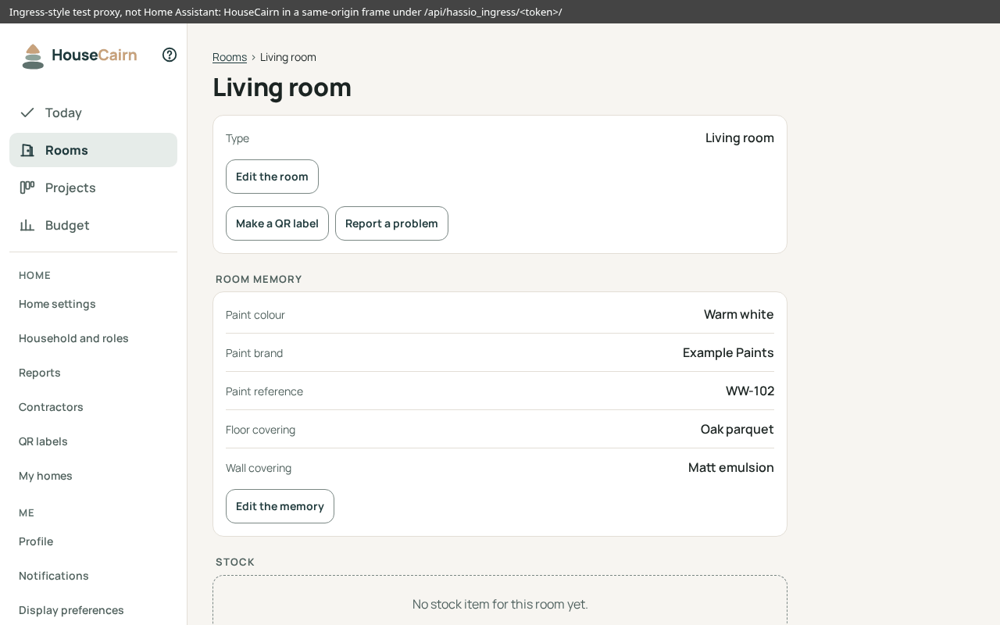

# Housecairn apps for Home Assistant

Run [Housecairn](https://github.com/HouseCairn/housecairn), the self-hosted
planner for home maintenance and renovation work, as a Home Assistant app
(formerly "add-on"), opened from Home Assistant's sidebar.

  

Housecairn served under an ingress path, in a frame of the same origin.
Taken with a small test proxy that does what the Supervisor does (path prefix,
`X-Ingress-Path` header, same-origin frame), not inside Home Assistant, on
made-up data.

Documentation: the app's [DOCS.md](housecairn/DOCS.md) (its **Documentation**
tab in Home Assistant), and Housecairn's at <https://docs.housecairn.app>.

## What it does

- Installs Housecairn on Home Assistant OS, or any installation with the
  Supervisor, on `amd64` and `aarch64` (64-bit only).
- Opens it inside Home Assistant through **ingress**, with an optional
  **sidebar** entry for every user; Housecairn keeps its own sign-in.
- Keeps everything (SQLite database, photos, files, secret key) in the app's
  folder, **included in Home Assistant backups**; the app is stopped during a
  backup for a consistent copy.
- Creates the **first administrator** from a one-time code written in the
  app's **Log** tab: no shell needed.
- Builds on Housecairn's published image, with a few options (host names,
  language, time zone, public address, single sign-on).
- Runs with **least privilege**: no host network, no Home Assistant API access,
  no access to other folders, no added capability.

## Install

1. In Home Assistant, go to **Settings** > **Apps** and select **Install app**.
2. In the top-right menu, select **Repositories**, enter
   `https://github.com/HouseCairn/home-assistant-addons` and select **Add**
   (or use the button above).
3. Select **Housecairn**, then **Install**. The Supervisor builds the app on
   your device over Housecairn's image: about a minute.
4. On the **Info** tab, select **Start**, then **Open web UI**. Turn on
   **Show in sidebar** to keep it at hand. Nothing to configure first:
   through ingress, every name or address of Home Assistant works.
5. On the **Log** tab, copy the **First-account code**. In the web UI, follow
   the link of the sign-in page to the first-account screen, and give the code,
   your name, your email address and a password.

Each step is detailed in [DOCS.md](housecairn/DOCS.md#install).

## Integrations

- **Tasks in Home Assistant**: the separate
  [Housecairn integration](https://github.com/HouseCairn/home-assistant-housecairn)
  shows the tasks of a home as sensors and a to-do list. It calls Housecairn
  with a **Housecairn API token**, never with a Home Assistant token. Create it
  in Housecairn, under **More** > **Me** > **API tokens**: tick **Read** and
  **Write** (Write marks tasks done), choose the home, and copy the token,
  which is shown once. The integration needs an address that reaches the app
  without Home Assistant's interface, such as [the port](housecairn/DOCS.md#the-port),
  with that name or address in **Host names**, which applies once the port is
  open ([Host names](housecairn/DOCS.md#host-names)).
- Housecairn's own integrations (notifications, calendar feeds, API) work as in
  any other installation: see <https://docs.housecairn.app>.

## Known limits

From [DOCS.md](housecairn/DOCS.md#limits), where each is explained:

- Links meant for outside Home Assistant (calendar feeds, QR labels,
  invitations, emails) need a **public address** that reaches the app without
  Home Assistant, such as its port.
- The port is **plain HTTP**, and so is ingress when Home Assistant itself is
  reached in plain HTTP.
- **No passkeys and no open sign-up on the port**: both need HTTPS.
- Through ingress, **failed sign-ins are counted per Home Assistant**, not per
  device.
- **SQLite only**: no PostgreSQL.
- **No AppArmor profile of its own yet**: Docker's default profile.

## Project status

**Experimental.** The app's version is the version of the Housecairn image it
is built from (currently `0.2.0`), a test version.
Updates may change behaviour: read the [changelog](housecairn/CHANGELOG.md)
and make a backup first.

## Privacy and security

- **Self-hosted**: the data stays in the app's folder on your Home Assistant
  machine and in its backups.
- **No telemetry, no tracker**: Housecairn makes no outgoing connection you have
  not configured.
- The forwarded headers of ingress (path, HTTPS) are trusted from the
  Supervisor only, and only a page of Home Assistant's own address may show
  Housecairn in a frame. The design choices are in
  [docs/decisions.md](docs/decisions.md).
- Report a vulnerability as described in Housecairn's
  [SECURITY.md](https://github.com/HouseCairn/housecairn/blob/main/SECURITY.md),
  not in a public issue.

## Contributing

Issues and pull requests are welcome. Contributions follow Housecairn's
[CONTRIBUTING.md](https://github.com/HouseCairn/housecairn/blob/main/CONTRIBUTING.md):
the [Contributor License Agreement](https://github.com/HouseCairn/housecairn/blob/main/CLA.md)
and a `Signed-off-by` line on each commit. AI coding agents start with
Housecairn's [AGENTS.md](https://github.com/HouseCairn/housecairn/blob/main/AGENTS.md)
and this repository's [docs/decisions.md](docs/decisions.md).

Housecairn is developed with an AI coding agent, under human review; each pull
request states which AI tool and model were used.

## License

Housecairn, by Robvred. This repository is licensed under the GNU Affero
General Public License, version 3 only (`AGPL-3.0-only`), with the additional
terms of [NOTICE](NOTICE). The name and the logo of Housecairn are not covered
by the license (see `NOTICE`).
